# SC Arbitrage Speed — подробная архитектура расчётов

Это карта того, **как бот уменьшает число дорогих операций**, рассчитывает исполнение по глубине и повторно использует результаты. Исходное ядро отделено от локальной упаковки. Каждая стадия ниже привязана к файлу и функции; направленные связи означают передачу данных, ромбы — реальную ветку решения.

## Карта чтения

1. [Конвейер и контракты данных](#1-конвейер-и-контракты-данных)
2. [Отбор направлений](#2-отбор-направлений-до-дорогой-математики)
3. [Сети и комиссия перевода](#3-сеть--часть-ключа-связки)
4. [Исполнение по глубине](#4-исполнение-по-глубине-стакана)
5. [Поиск объёма](#5-поиск-объёма-и-мемоизация)
6. [Инкрементальный пересчёт](#6-пересчёт-только-затронутых-связок)
7. [Индекс пользователей и группировка](#7-индекс-диапазонов-и-групповой-расчёт)
8. [Дедупликация и доставка](#8-один-payload--несколько-получателей)
9. Нативный транспорт, процессы и доступ — в нижней части этой страницы.

## 1. Конвейер и контракты данных

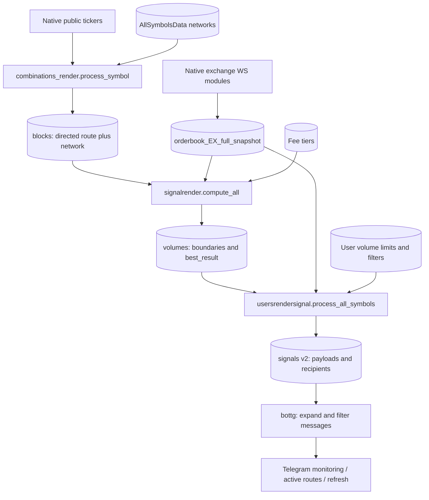

| Контракт | Кто пишет → кто читает | Что важно |
|---|---|---|
| `AllSymbolsData` | metadata → combinations | `symbol`, `currency[exchange].networks[network]` |
| `blocks` | combinations → signalrender | Список `[route_key, [symbol,buy,sell,network,buy_networks,sell_networks]]` |
| `orderbook_*_full_snapshot` | нативный WS → оба расчётных этапа | Полная книга по символу, собственное время получения |
| `volumes` | signalrender → usersrendersignal | `min_boundary`, `max_boundary`, `best_volume`, `best_result`, комиссии и маршрут |
| `signals` version 2 | usersrendersignal → bottg | Один общий payload плюс отдельная карта получателей |

Это последовательность снимков, не транзакционный снимок всех бирж в одну наносекунду. Свежесть и рассинхронизация проверяются отдельно.

## 2. Отбор направлений до дорогой математики

Источник: [`process_symbol`](../newbot/render/combinations_render.py), `SYMBOL_FORMATTERS`, `_price`.

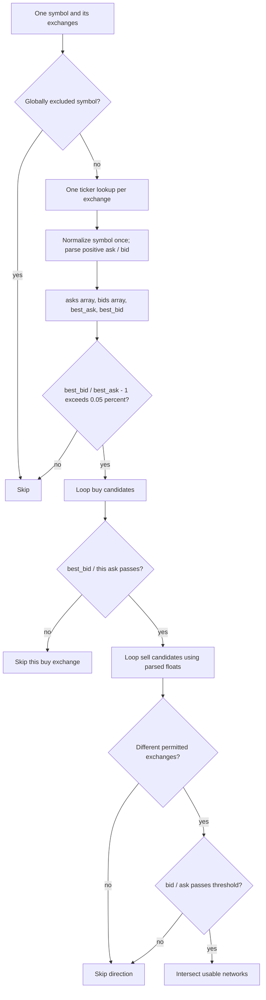

Сильное решение — **верхняя оценка**. Если даже самый высокий bid не превышает самый низкий ask на порог, ни одно направление по символу его не превысит. Достаточно O(E) чтений тикеров, чтобы отбросить символ целиком. Для прошедших символов остаётся O(E²) сравнений направлений, но уже без повторного форматирования строк и парсинга цен на каждой паре.

Вторая отсечка `best_bid / ask` убирает сразу все продажи для дорогой биржи покупки. Порог 0,05% — только предварительный фильтр цен; он ещё не учитывает глубину и все комиссии. Не называем его гарантированным чистым спредом.

Исторические исключения `OKX` и `CoinEx ↔ Bitmart` явно заданы в `EXCLUDED_EXCHANGES/EXCLUDED_PAIRS`; они не связаны с ID администратора и сохранены как ограничения стратегии.

## 3. Сеть — часть ключа связки

Источник: `ArbitrageBot.collect_blocks`.

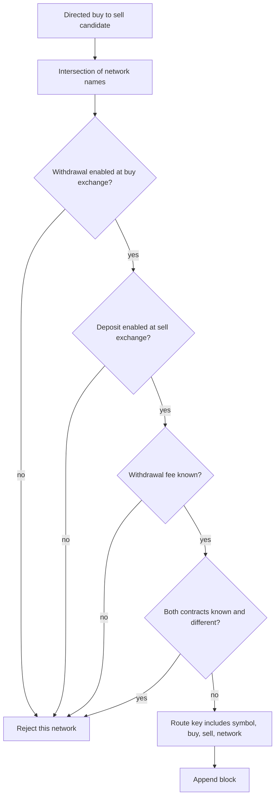

Один токен и две биржи могут дать несколько расчётных маршрутов с разными сетями и комиссиями. `fee` выражается в базовом активе, поэтому её долларовая стоимость зависит от цены. Неизвестная комиссия — не ноль. Защита от несовпадающих известных контрактов и запрет неизвестной комиссии усилены в переносимой редакции; отсутствие контрактов не доказывает их тождество.

## 4. Исполнение по глубине стакана

Источник: `MathSignalsBot.orderbookMath` в [`signalrender.py`](../newbot/render/signalrender.py).

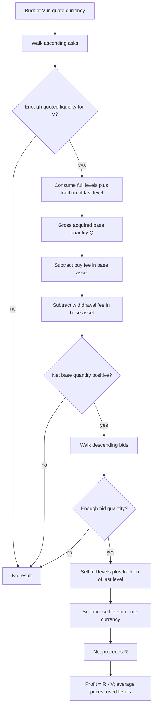

Пусть asks — `(aᵢ,qᵢ)`. До последнего использованного уровня покупаются полные количества, а остаток бюджета делится на цену последнего уровня. Это даёт Q, а не фиктивную покупку всего объёма по лучшей цене.

- `Q_net = Q × (1 − buy_taker_rate) − withdrawal_fee`.
- По bids продаётся именно `Q_net`, также с частичным последним уровнем.
- `R = gross_quote_proceeds × (1 − sell_taker_rate)`.
- `profit = R − V`; средняя покупка `V / Q`; средняя продажа `R / Q_net`.

Пример из регрессионного теста: V=100, ask=10, bid=11, комиссии обеих сделок 0,1%, сеть бесплатна → Q=10, Q_net=9,99, R=109,78011, прибыль 9,78011. Это синтетический пример математики, не рыночное обещание.

Возвращаются также первый/последний уровни, число затронутых уровней, количества токенов и дополнительные показатели продающей ликвидности. BitMart имеет отдельную таблицу тиров и fallback 0,25%; это расчётная настройка исходного кода, не персональный тариф аккаунта. Защиты от нехватки глубины исключают экстраполяцию несуществующих заявок.

## 5. Поиск объёма и мемоизация

Источник: `optimized_linear_search_volume`; название историческое, внутри используется сужение диапазона.

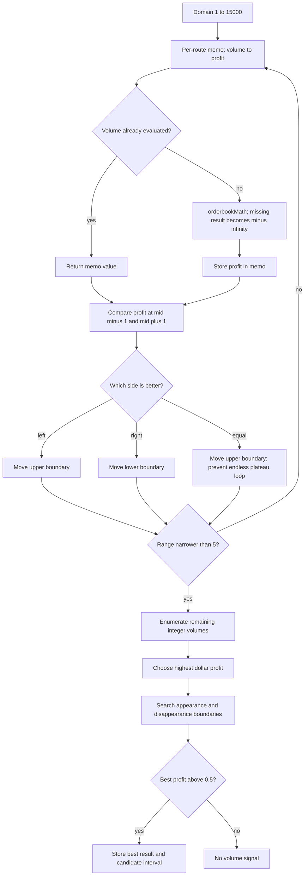

Снижение затрат достигается двумя приёмами: сужением области поиска и memo для повторных проб одного V внутри одного маршрута. Финальный короткий диапазон перебирается непосредственно. Поиск границ и пика — **эвристика исходного кода**: кусочно-линейная глубина, комиссии и недоступные объёмы не дают безусловной гарантии единственного максимума. Диаграмма описывает текущий алгоритм; это не доказательство глобальной оптимальности для произвольного стакана. Порог 0,5 — абсолютная прибыль в валюте котировки.

## 6. Пересчёт только затронутых связок

Источник: `update_local_orderbooks`, `_combo_signature`, `compute_all`, `update_tiers`.

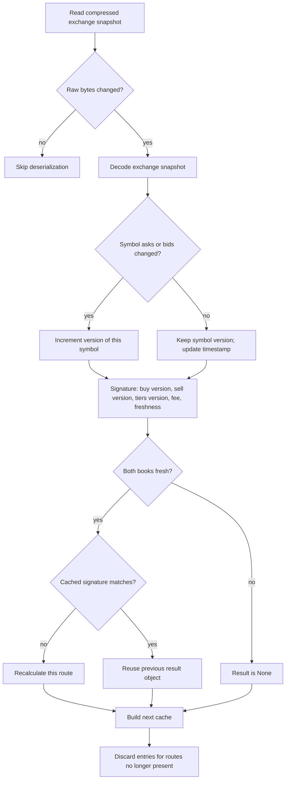

Важна гранулярность: обновление ETH на бирже не обязано инвалидировать BTC-связку. Версия символа меняется по содержимому asks/bids, не просто по heartbeat. Изменение комиссии сети или тиров также входит в условия пересчёта. Два слоя кэша решают разные задачи: raw-byte сравнение экономит распаковку, `combo_cache` — дорогую математику.

Расчёт вызывается через `asyncio.to_thread`; сетевые циклы event loop продолжают обслуживаться. Это разгружает loop от синхронного вызова, но не обещает линейного ускорения CPU в Python.

## 7. Индекс диапазонов и групповой расчёт

Источник: `UserVolumeIndex`, `_bucket`, `process_symbol` в [`usersrendersignal.py`](../newbot/render/usersrendersignal.py).

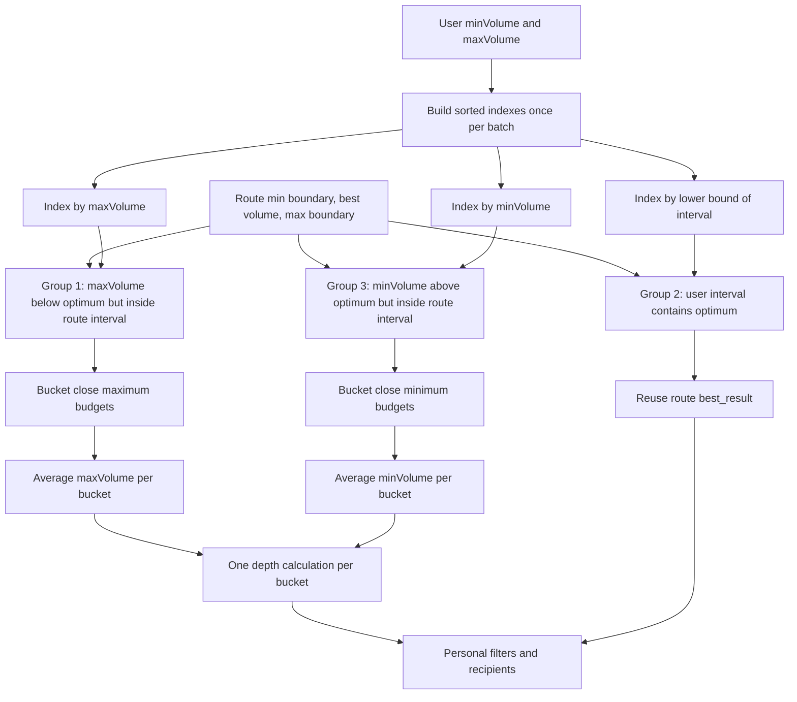

Границы групп точные:

- G1: `min_boundary ≤ maxVolume < best_volume` — два `bisect_left` по maxVolume.
- G2: `minVolume ≤ best_volume ≤ maxVolume` — префикс по нижней границе и проверка верхней.
- G3: `best_volume < minVolume ≤ max_boundary` — два `bisect_right` по minVolume.

G2 не является O(log U) целиком: после бинарного определения префикса остаётся просмотр кандидатов. G1/G3 также требуют извлечения найденных пользователей. Выигрыш — устранение повторных полных проходов и повторной математики; стоимость вывода K пользователей никуда не исчезает.

| Подгруппа | Шаг округления бюджета |
|---|---|
| G1 до 200 | 2 |
| G1 до 400 / 800 / 1400 | 5 / 10 / 20 |
| G1 выше 1400 | 40 |
| G3 до 200 / выше | 2 / 5 |

Внутри bucket сохраняется первоначальный порядок пользователей перед суммированием: это удерживает тот же порядок floating-point сложения и воспроизводимость среднего. Для bucket берётся средний лимит — это групповой приближённый выбор бюджета, не индивидуальная оптимизация каждого пользователя. В персональной установке пользователь один, но исходная масштабируемая структура сохранена.

## 8. Один payload — несколько получателей

Источник: `load_signal_every_user`, `load_all_signals`, `signal_payloads`, `signal_recipients`; чтение — `bottg.py`.

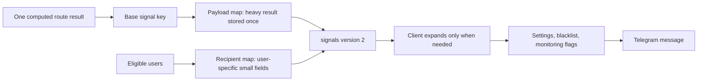

Вместо копирования большого словаря каждой связки каждому пользователю общий результат отделён от карты адресатов. Публикация копирует словарь payload поверхностно и отдельно карты получателей под lock; сжатие и запись вынесены через `to_thread`. Память зависит от числа уникальных результатов и небольших записей получателей, а не от полного дублирования каждого тела сообщения.

## 9. Где экономится работа

| Решение | Устраняемая работа | Граница применимости |
|---|---|---|
| Верхняя оценка ask/bid | Перебор явно бесперспективного символа | Только предварительный ценовой фильтр |
| Нативный raw coalescing | Парсинг промежуточных полных снимков | Не для delta-потока |
| Версия символа | Пересчёт несвязанных маршрутов | Комиссии и свежесть тоже учитываются |
| Memo объёма | Повторный расчёт одной пробы V | Локально одному поиску |
| Индекс пользователей | Полные повторные проходы по лимитам | Остаточная выборка G2 линейна по префиксу |
| Bucket объёмов | Одинаковая математика близких лимитов | Групповой, не персональный оптимум |
| Payload/recipients | Копирование тяжёлого сигнала | Нужна корректная инвалидизация адресатов |

## Реальные границы реализации

Исходный сбор стаканов — **собственные адаптеры в `newbot/webSockets/`**, а не CCXT/CCXT Pro. Первая переносимая редакция ошибочно подменила их универсальной библиотекой; текущая редакция эту подмену устраняет. `portable/native_ws.py` запускает оригинальные классы в отдельных процессах. `portable/native_rest.py` — небольшой прямой HTTP-слой для публичных тикеров и выбора пар; это добавленная инфраструктура переносимости, не авторское расчётное ядро.

Серверные процессы проверены отдельно от наличия файлов: присутствие `client_auto.py` или альтернативного `*2.py` в архиве не означает, что файл участвует в работающем боте. Старый отдельный эксперимент `client_auto.py` с CCXT исключён из поставки. В репозитории остаются исходные специализированные адаптеры для изучения, но активный путь перечислен ниже.

### Транспорт по биржам

| Биржа | Реальный модуль | Особенность обработки |
|---|---|---|
| KuCoin | `newbot/webSockets/kucoin.py` | Публичный `bullet-public`; `level2Depth50`; последний raw-снимок и отложенный разбор |
| Bitget | `newbot/webSockets/bitget.py` | `books15`; выделение instId; замена pending-снимка; сортировка asks/bids |
| BingX | `newbot/webSockets/bingx.py` | Сжатые сообщения; heartbeat; последний raw-снимок перед разбором |
| HTX | `newbot/webSockets/htx.py` | Сжатие gzip, ping/pong, отложенная обработка полных depth-снимков |
| MEXC | `newbot/webSockets/mexc.py` | Бинарный Protobuf `PushDataV3ApiWrapper`; limited depth; backoff переподключения |
| Bybit | `newbot/webSockets/bybit.py` | Отдельная обработка snapshot/delta, обновление и удаление ценовых уровней |
| CoinEx | `newbot/webSockets/coinex.py` | Собственный декодер; локальная редакция обновлена на v2/spot, полные снимки; исходный поток на символ |
| Gate | `newbot/webSockets/gate.py` | Собственный WebSocket-клиент, `spot.order_book`, ограниченные полные снимки |
| BitMart | `newbot/webSockets/bitmart.py` | Менеджер подписок, собственный декодер и общий снимок |
| OKX | `newbot/webSockets/okx.py` | В локальной редакции `books5`: полные снимки; исправлен разбор дополнительных колонок |

KuCoin получает **публичный временный токен транспорта**, автоматически: это не персональный API-ключ биржи. Везде используются публичные потоки; кошелёк и торговые полномочия не запрашиваются.

### Почему отложенный JSON-разбор экономит работу

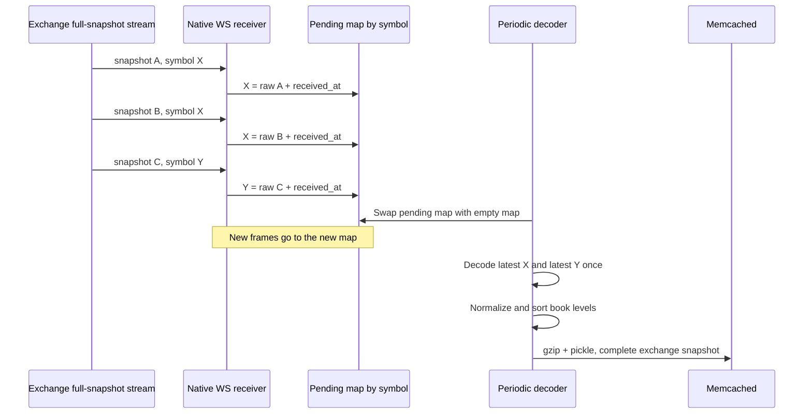

Это **coalescing полных снимков**: если пришло несколько самодостаточных книг одного символа, промежуточные можно заменить последней до дорогого JSON-разбора. Если за интервал пришло M кадров по S символам, количество разборов ограничено числом обновившихся символов, а не M. Эта логика применима только к полным снимкам. Для delta-потоков пропуск промежуточного обновления повреждает состояние: поэтому нельзя механически переносить оптимизацию KuCoin/Bitget в обработчик Bybit/CoinEx.

### От независимых потоков к единому формату

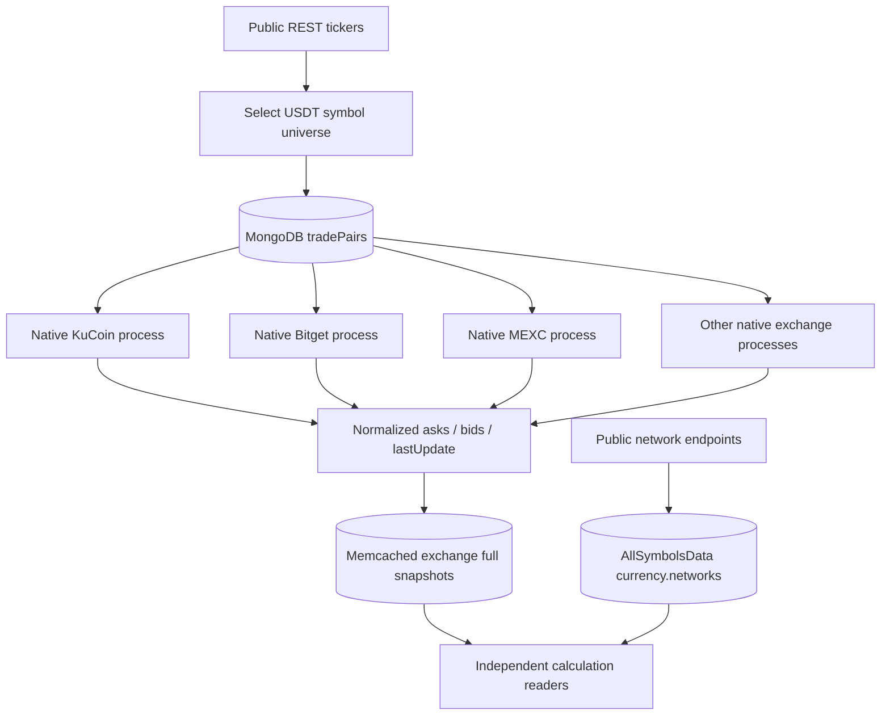

Формат — словарь `native_symbol → {asks, bids, lastUpdate}`. Имена бирж исторически различаются: MM использует `MEXC`, арбитраж — `MEXC Global`; адаптер совместимости зеркалирует ключ. OKX исходно писал per-symbol ключи; локальный runner объединяет их в полный снимок. Основные нативные сборщики публикуют примерно раз в 2 секунды с TTL 10 секунд; конкретный цикл смотрите в соответствующем `update_database`/`update_cache`, а не в универсальном обещании одинаковой частоты.

### Асинхронность и восстановление: что действительно параллельно

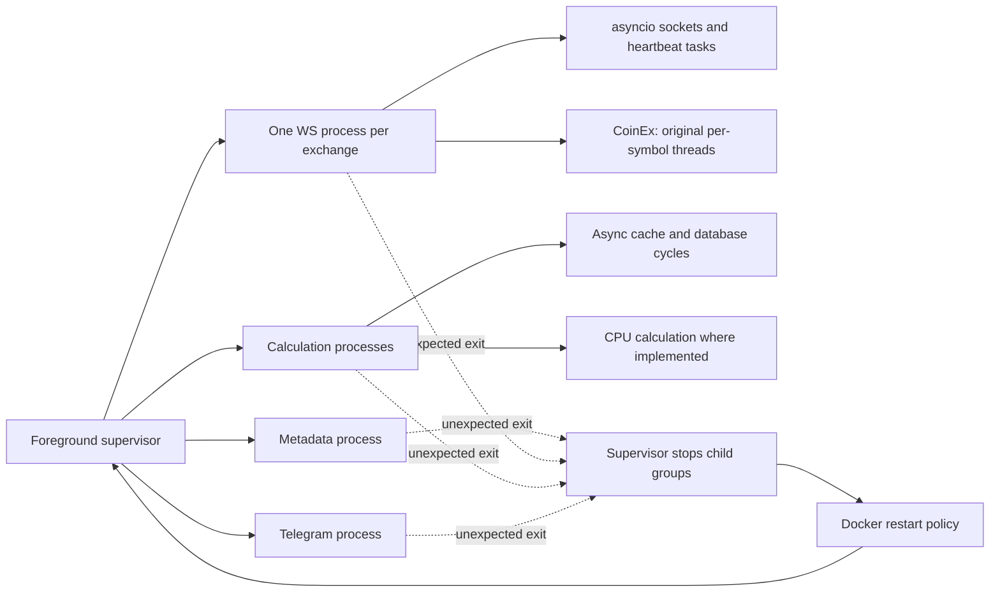

Процессы изолируют тяжёлые циклы друг от друга; `asyncio.gather` внутри процесса перекрывает ожидание сети, но не делает Python-математику автоматически многопроцессной. Синхронные обращения к кэшу в исходных модулях ещё есть. У бирж разные схемы reconnect; экспоненциальный backoff подтверждён, например, в MEXC, но не приписывается всем сборщикам.

TTL снимка и возраст конкретной книги — разные проверки: процесс может заново записать старую книгу и продлить TTL. Поэтому расчёты дополнительно проверяют `lastUpdate` (30 секунд), а пользовательский арбитражный расчёт — ещё и рассинхронизацию двух книг (10 секунд).

### Персональная локальная установка

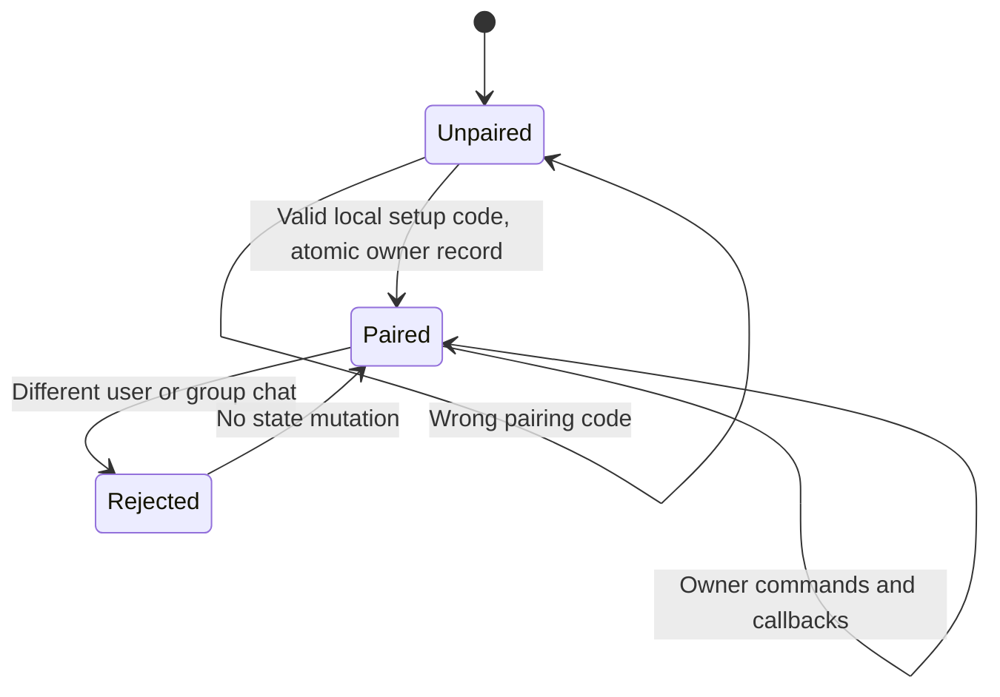

`portable/access.py` хранит одного локально привязанного пользователя. Middleware проверяет сообщения и callback до бизнес-обработчиков. Здесь нет специальной роли автора проекта, его ID, кнопок продажи доступа, добавления/удаления подписчиков, служебного управления общими списками или адреса поддержки владельца. Пользовательские настройки, избранное и личные чёрные списки сохранены.

### Проверяемость вместо декоративных обещаний

Схемы показывают вызовы и структуры данных, подтверждённые исходниками. Они не утверждают измеренную пропускную способность, точность определения маркет-мейкера или гарантированную прибыль. `VALIDATION.md` отделяет unit/import проверки, Docker-интеграцию и реальные сетевые пробы. Доступность API зависит от сети; данные о переводах описаны в [DATA_COVERAGE.md](DATA_COVERAGE.md).
