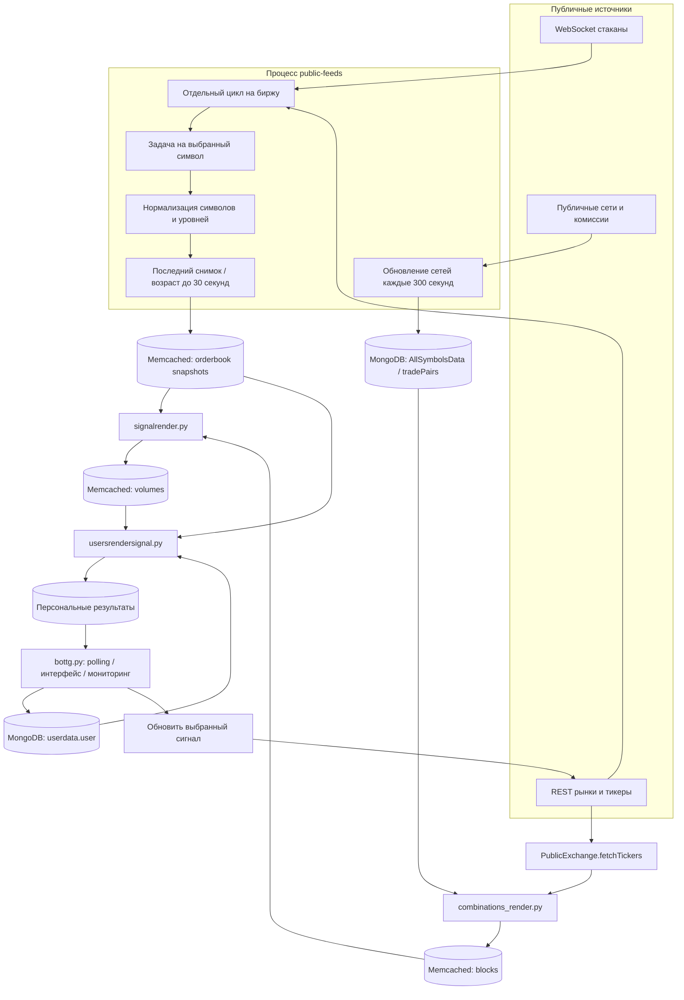
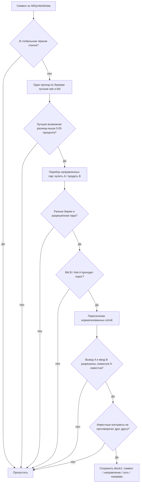
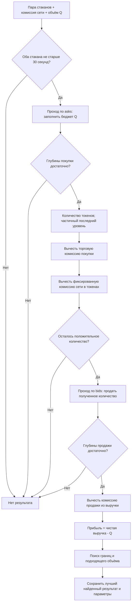
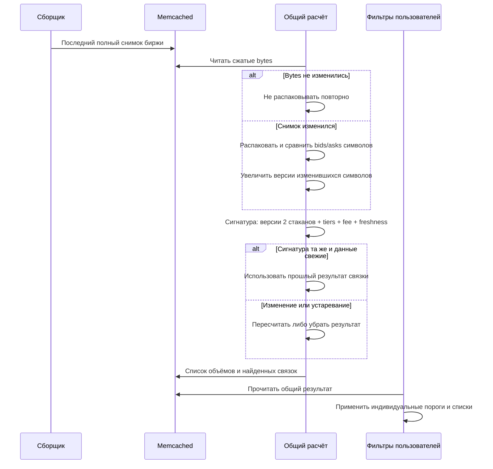

# Внутри SC Arbitrage Speed

Эта схема описывает переносимую сборку и реальные модули исходного бота. Стандартный запуск заменяет серверный сбор данных публичным слоем `portable/`, сохраняя расчётные стадии и Telegram-интерфейс.

## 1. Процессы и движение данных

`portable.launch` следит за дочерними процессами. Если один неожиданно завершился, вся группа останавливается; Docker перезапускает её как единый стек. Остановка передаётся группам процессов, включая дочерние процессы Telegram-модуля. Это предотвращает незаметную работу интерфейса с умершим расчётным процессом.

## 2. Как появляется кандидат маршрута

Реализация: `ArbitrageBot.process_symbol` и `collect_blocks` в `newbot/render/combinations_render.py`.

Ранняя верхняя оценка сокращает число дорогих расчётов: если даже минимальный ask и максимальный bid не дают порог, прочие комбинации бессмысленны. Форматирование символов вынесено в таблицу функций. Общие сети проверяются через поиск по словарям.

Сохранённые особенности исходной стратегии: OKX исключён из генератора маршрутов; связки CoinEx ↔ BitMart исключены в обе стороны. Это отдельные правила стратегии, а не отсутствие этих бирж в сборщике.

## 3. Расчёт по реальной глубине

Реализация: `MathSignalsBot.orderbookMath`, `optimized_linear_search_volume`, `signalLoops`.

В расчёте хранятся средние и граничные цены покупки/продажи, число пройденных уровней, количество купленных/проданных токенов, итоговая выручка и разница в USDT. Поиск объёма использует диапазон исходной стратегии до 15 000 USDT и мемоизацию повторных запросов. Это эвристический поиск по текущему снимку, а не доказательство глобального максимума прибыли.

Комиссии taker заданы исходными расчётными таблицами. Они требуют сверки с реальными тарифами пользователя. Для BitMart сохраняется логика tiers и запасная ставка при недоступных tiers. Неизвестная сетевая комиссия не считается нулевой.

## 4. Почему повторный цикл не пересчитывает весь рынок

Пользовательская стадия использует группировку диапазонов объёма и поиск границ, чтобы не повторять одинаковые вычисления для каждого пользователя. При отображении применяются ограничения объёма, минимального процента/долларовой разницы, максимальной комиссии, выбранных бирж, списков токенов и сетей. Кнопка обновления делает отдельную проверку выбранной связки по текущим публичным стаканам.

## 5. Асинхронность и устойчивость

| Механизм | Где | Зачем |
|---|---|---|
| Цикл на биржу | `portable.feeds.run_exchange` | Ошибка одной площадки не останавливает другие |
| Задача на символ | `watch` | Одновременное ожидание независимых потоков |
| Backoff 1 → 2 → … → 60 с | `watch` | Не создавать шторм повторных подключений |
| Таймаут WebSocket 45 с | `watch` | Не ждать молча бесконечно |
| Снимок раз в секунду | `publish` | Отделить частоту сети от частоты расчёта |
| TTL / абсолютный возраст 30 с | Сборщик и расчёт | Не показывать прибыль на старых стаканах |
| Кэш тикеров 5 с | `PublicExchange.fetchTickers` | Не делать одинаковые REST-запросы подряд |
| Процессы + общий кэш | `portable.launch` | Разделить сеть, CPU-расчёт и Telegram |

Число подписок ограничивает профиль установки. Нет обещания микросекундной реакции или биржевого HFT: это Python-аналитика с периодическими снимками. Публичные API, сеть пользователя и частота стратегии задают реальную задержку.

## Карта исходников

| Файл | Ответственность |
|---|---|
| `portable/feeds.py` | Публичный сбор, нормализация, TTL и справочники |
| `portable/public_exchange.py` | Совместимый интерфейс тикеров и стаканов без ключей |
| `portable/rest_fallback.py` | REST-провайдеры CoinEx/BitMart при отсутствии в CCXT |
| `newbot/render/combinations_render.py` | Направленные маршруты и сети |
| `newbot/render/signalrender.py` | Глубина, комиссии, поиск объёма, версии |
| `newbot/render/usersrendersignal.py` | Персональные результаты и группировка расчётов |
| `newbot/client/bottg.py` | Telegram UX, настройки и мониторинг |
| `portable/access.py` | Привязка владельца и начальный профиль |

Покрытие бирж и данных — в [DATA_COVERAGE.md](DATA_COVERAGE.md).
